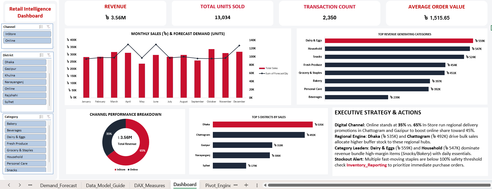
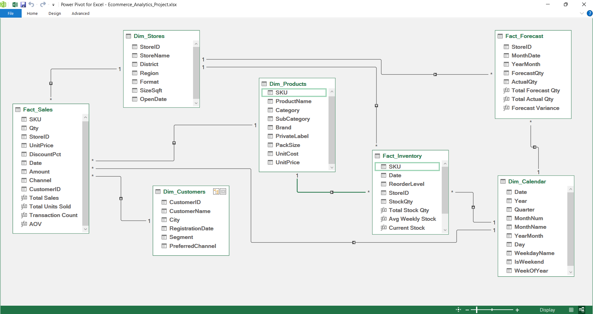

# Retail Intelligence Dashboard

An end-to-end retail analytics project built entirely in **Microsoft Excel**. Messy raw sales and inventory exports are cleaned with **Power Query**, modelled as a **galaxy schema in Power Pivot** (three star schemas sharing the same dimensions), measured with **DAX**, and presented as an interactive executive dashboard with slicers that cross-filter every chart.



---

## Business questions

A grocery chain with **15 physical stores across 8 districts plus an online store** wants one place to answer:

1. How much are we selling, and is it on track against forecast month by month?
2. How is revenue split between in-store and online?
3. Which districts and product categories drive revenue?
4. Which SKUs are running low against their reorder level?

## Headline results (full year 2024)

| KPI | Value |
|---|---|
| Total revenue | **৳ 3.56M** |
| Units sold | **13,034** |
| Transactions | **2,350** |
| Average order value | **৳ 1,515.65** |
| Channel split | **65% In-Store / 35% Online** |
| Top district (physical stores) | **Dhaka: ৳ 535K**, then Chattogram ৳ 492K, Gazipur ৳ 318K |
| Top categories | **Dairy & Eggs ৳ 559K**, Household ৳ 547K, Snacks ৳ 524K |

---

## Tools and skills

| Area | What was used |
|---|---|
| Data cleaning (ETL) | Power Query (M): type fixing, multi-format date parsing, text standardisation, de-duplication, **unpivot**, **append** |
| Data modelling | Power Pivot: galaxy schema (fact constellation), 3 fact tables, 4 conformed dimensions, 9 one-to-many relationships |
| Calculations | DAX: `SUM`, `COUNTROWS`, `AVERAGE`, `DIVIDE` |
| Reporting | PivotTables and PivotCharts from the Data Model, slicers with report connections, dynamic KPI cards linked to cells, custom number formats |
| Design | F-pattern dashboard layout and a consistent colour system |

---

## Repository contents

```
├── Retail_Intelligence_Dashboard.xlsx   ← the full working project
├── images/                              ← screenshots (dashboard, data model)
├── power-query/                         ← M code for all 9 queries, one file each
├── dax/measures.dax                     ← every DAX measure in the model
└── docs/
    ├── build_guide.md                   ← step-by-step guide to rebuild the project
    └── data_dictionary.md               ← every table, column and relationship
```

### Workbook sheets

| Layer | Sheets |
|---|---|
| **Presentation** | `Dashboard`, `Inventory_Reporting` |
| **Calculation** | `Pivot_Engine`: the backend PivotTables that feed the KPI cards and charts |
| **Documentation** | `Data_Model_Guide`, `DAX_Measures` |
| **Clean data** | `Clean_InStore`, `Clean_Online` (Power Query outputs) |
| **Reference data** | `Dim_Products`, `Dim_Stores`, `Dim_Customers`, `Dim_Calendar`, `Demand_Forecast` |
| **Raw data** | `Raw_InStore_Sales`, `Raw_Online_Sales`, `Raw_Inventory_Snapshot` (untouched source exports) |

---

## How it works

### 1. Data pipeline (Power Query)

```
Raw_InStore_Sales ──► Clean_InStore ──┐
                                      ├──► Fact_Sales (append) ──┐
Raw_Online_Sales  ──► Clean_Online  ──┘                          │
Raw_Inventory     ──► Fact_Inventory (unpivot wide → long) ──────┼──► Data Model
Demand_Forecast   ──► Fact_Forecast ─────────────────────────────┤
Dim_* tables      ──► typed dimension queries ───────────────────┘
```

The raw exports contain realistic problems, all fixed in Power Query:
- **4 different date formats** in one column, plus mixed date-time formats online
- Prices stored as text with a currency symbol (`৳400.20`)
- Inconsistent labels (`cash` / `CASH`, `bkash` / `BKASH`, `cod` / `COD`)
- Stray spaces, hidden characters, lower-case codes and duplicate rows
- Discounts stored as `10` in one source and `0.10` in the other
- Inventory in a **wide layout** (one column per store), unpivoted into 8,634 rows

See [`docs/build_guide.md`](docs/build_guide.md) for every step, and [`/power-query`](power-query) for the code.

### 2. Data model (galaxy schema)

The model is a **galaxy schema**, also called a *fact constellation*: three fact tables, each forming its own star, that share **conformed dimensions** (`Dim_Stores`, `Dim_Products`, `Dim_Calendar`). Sales, inventory and forecast are recorded at different levels of detail (daily transactions, weekly store-SKU snapshots, monthly store forecasts), so they can't live in one fact table. Shared dimensions let them still be filtered together.



- **Fact_Sales** (2,350 rows) → Products, Stores, Customers, Calendar
- **Fact_Inventory** (8,634 weekly snapshots) → Products, Stores, Calendar
- **Fact_Forecast** (180 store-months) → Stores, Calendar

Shared dimensions let one **District** or **Category** slicer filter sales and inventory together, and one calendar lines up sales with forecast on the same monthly axis. Full detail is in the [data dictionary](docs/data_dictionary.md).

### 3. Measures (DAX)

| Measure | Formula |
|---|---|
| Total Sales | `SUM(Fact_Sales[Amount])` |
| Total Units Sold | `SUM(Fact_Sales[Qty])` |
| Transaction Count | `COUNTROWS(Fact_Sales)` |
| AOV | `DIVIDE([Total Sales], [Transaction Count], 0)` |
| Current Stock | `CALCULATE(SUM(Fact_Inventory[StockQty]), LASTDATE(Fact_Inventory[Date]))` |
| Stock Health Ratio | `DIVIDE([Current Stock], [Reorder Point], 0)` |
| Forecast Variance | `[Total Actual Qty] - [Total Forecast Qty]` |

All 12 measures are in [`dax/measures.dax`](dax/measures.dax).

### 4. Dashboard

- **Control panel (left):** Channel, District and Category slicers, each connected to every pivot so one click filters the whole page
- **KPI cards (top):** Revenue, Units Sold, Transactions and AOV, linked live to `Pivot_Engine`
- **Charts:** Monthly Sales vs Forecast (combo chart), Channel Split (donut), Top 5 Districts and Top Categories (bar charts)
- **Strategy & Actions card:** turns the numbers into recommendations covering digital growth, regional replenishment, category bundling and stock-out prevention

---

## Challenges and how I solved them

**1. A "(blank)" item appeared in the District slicer**
Online orders have no physical store, so their `StoreID` was empty. Power Pivot can't match a blank key, so it adds an "unknown member" to `Dim_Stores`, which shows up as **(blank)** in every store-based slicer. Ticking *Hide items with no data* doesn't remove it, because the blank lives inside the dimension itself.
**Fix:** I added a real `ONLINE` record to Dim_Stores (District = *Online*, Format = *E-commerce*) and filled the blank `StoreID`s in Power Query. Every sales row now links to a valid store, and the slicer shows a clean **Online** button.

**2. Linked KPI text boxes lost their currency formatting**
Text boxes linked with `=Pivot_Engine!$B$4` ignore PivotTable number formats and show raw decimals.
**Fix:** I applied custom formats directly to the source cells (`"৳ "#,##0.00,,"M"`, `"৳ "#,##0.00`, `#,##0`), which the linked shapes then inherit.

**3. The layout didn't fit a 16:9 screen**
Stacking four KPI cards vertically pushed the charts off-screen and left empty space.
**Fix:** I moved the KPI cards into a single row across the top and kept the left side as a slim slicer panel.

**4. Monthly forecast vs daily sales**
The forecast is monthly and sales are daily. Instead of a separate month table, `Fact_Forecast[MonthDate]` (always the 1st of the month) links to the same daily `Dim_Calendar`, so both measures share one month axis and react to the same filters.

**5. "Current Stock" was about 9× too high**
Inventory is a weekly *snapshot*, so stock can be added across stores but not across weeks. The first version used `SUM(StockQty)`, which added all 8 weeks together (e.g. 6,085 units for one SKU instead of 671).
**Fix:** I wrapped both **Current Stock** and **Reorder Point** in `CALCULATE(…, LASTDATE(Fact_Inventory[Date]))` so they read only the latest week. Using the fact table's own dates (not the calendar's 31 Dec) guarantees the latest week that actually has data. Result: **12 of 72 SKUs** are now correctly flagged below their reorder point (Stock Health Ratio < 1).

---

## Known limitations and next steps

- The **Category** slicer can't filter the forecast line, because the forecast is planned per store, not per product.
- In-store sales and 15 guest online orders have no customer ID, so customer-level analysis covers registered online customers only.
- Next step: add time-intelligence measures (MTD, prior-period growth) and an out-of-stock rate KPI.

---

## How to use

1. Download `Retail_Intelligence_Dashboard.xlsx` (click the file on GitHub, then the **Download raw file** button ⤓).
2. Open it in **Excel for Windows** (Power Pivot isn't available on Mac or the web, but the dashboard still displays there).
3. Click **Enable Content**, then use the slicers on the `Dashboard` sheet.
4. To see the model: **Power Pivot → Manage → Diagram View**. To see the queries: **Data → Queries & Connections**.

> The dataset is synthetic and was created for portfolio and practice purposes.

---

**Author:** Shajid Ahmed · [GitHub](https://github.com/Shajid1999)
